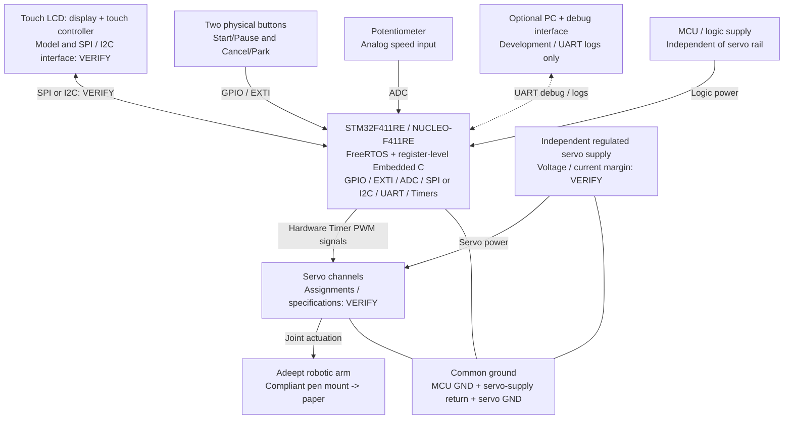
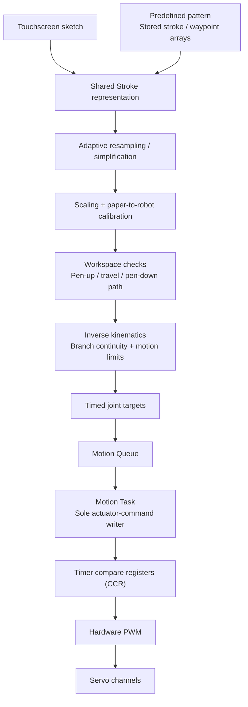

# MotionScribe: A Standalone Embedded Robotic Drawing System

**Course:** ESE 5190 — Smart Devices, University of Pennsylvania  
**Team:** Fangdong Yuan; Haoyu Shi; Ray Lin  
**Document:** Final Project Proposal — Draft  
**Date:** October 25, 2026

> This proposal describes planned work, not measured performance. **[VERIFY]** marks unresolved design choices or measurements; **[RISK]** marks feasibility or schedule concerns; **[OPTIONAL / P2]** marks extensions outside the required demonstrations. Team role assignments are provisional.

## 1. Abstract

MotionScribe is a standalone embedded robotic drawing system built around an STM32F411RE running FreeRTOS. It will reproduce touchscreen sketches and draw predefined patterns using one shared pipeline for stroke processing, inverse kinematics (IK), motion planning, and hardware-timer PWM output. Both demonstrations will run on the same firmware without a runtime PC dependency. The goal is repeatable, recognizable drawings with clean stroke separation, rather than precision-plotter accuracy.

## 2. Motivation

The project addresses the problem of translating intuitive, user-created drawings into executable robot motion on a resource-constrained embedded platform. A touchscreen sketch describes a shape, but a robotic arm needs calibrated coordinates, reachable joint targets, controlled timing, and reliable pen contact.

This is an interesting integration challenge because touch sampling, adaptive path processing, IK, servo uncertainty, and concurrent user interaction all affect the physical result. MotionScribe will serve as an interactive tabletop drawing demonstrator and a practical platform for connecting user input to embedded sensing, computation, and actuation. Success means recognizable shapes and repeatable operation under these constraints.

## 3. System Block Diagram

**Figure 1. Hardware architecture.** Solid arrows show signal or positive-power paths; undirected ground connections show the shared electrical reference. The PC connection is optional and used only during development/debugging.

The design includes the required analog input, at least two inputs and two outputs, and at least one SPI or I2C peripheral. Inputs are touch, buttons, and the ADC potentiometer; outputs are the LCD and robotic arm. Register-level Embedded C and FreeRTOS are the selected implementation approach. The exact touch controller, bus allocation, pin mapping, and logic-level compatibility remain **[VERIFY]**.

## 4. Design Sketches

**Figure 2. Overall tabletop setup — conceptual arrangement, not to scale.** The arm base and paper fixture are secured to the work surface. The touchscreen/UI, STM32 controller, and independent servo power supply are positioned alongside the drawing area; electrical connections are shown in Figure 1.

**Figure 3. Passive compliant pen mount — conceptual section, not to scale.** A spring illustrates one possible elastic element; rubber band or compliant-tube alternatives remain under evaluation.

The passive compliant mount is a baseline design intended to absorb Z-height variation and reduce excessive contact force. We will characterize travel, preload, friction, return behavior, and lateral play. A custom guide/frame may require 3D printing. Passive compliance does not actively lift the pen: **[VERIFY]** pen-up/down will use arm Z motion or a dedicated lift mechanism after evaluating clearance, load, and repeatability. No extra lift servo is assumed in the BOM. **[OPTIONAL / P2]** FSR pressure sensing will follow passive-mechanism characterization if time permits.

## 5. Software Requirements Specification (SRS)

These are proposed, testable acceptance targets, not completed results.

| ID | Requirement | Verification method |
| --- | --- | --- |
| SRS-01 | The system shall run both P0 demonstrations on the same firmware through a shared drawing pipeline without a runtime PC connection. | Perform touchscreen sketch reproduction and predefined-pattern drawing from onboard input to physical output with the PC disconnected. |
| SRS-02 | During drawing, the system shall process Start/Pause/Cancel events within 100 ms. This specifies event-processing latency, not mechanical stopping time. | Timestamp input acquisition and corresponding command/state handling under UI and planning load. |
| SRS-03 | The system shall reject every request in a defined invalid-path test set before drawing motion begins and display an error reason. | Submit out-of-workspace, unreachable, and joint-limit-violating paths; verify rejection before actuator execution. |
| SRS-04 | Each P0 demonstration shall complete five consecutive trials without motion-queue corruption or out-of-bounds writes. Cancellation shall prevent further execution of unexecuted targets from the canceled path. | Retain trial results and buffer-bound checks; run separate cancellation tests at different stages and verify that no old queued targets execute afterward. |

## 6. Hardware Requirements Specification (HRS)

| ID | Requirement | Verification method |
| --- | --- | --- |
| HRS-01 | Active servo channels shall produce PWM periods of 20.0 ms ± 0.2 ms and pulse widths within 10 µs of commanded values. Initial scope is three channels; the final channel count depends on the lift design. | Capture all active PWM channels using an oscilloscope or logic analyzer under UI and planning load. |
| HRS-02 | The system shall provide touch input, two physical buttons, and an ADC-connected speed potentiometer. Each input shall perform its assigned function in 10 repeated trials; the knob shall distinguish Slow/Normal/Fast settings in 10 selection cycles. | Log touch/button events and ADC classifications; check sketch/pattern input, button actions, and all three speed settings. |
| HRS-03 | The system shall complete five consecutive drawings without MCU resets caused by servo power disturbances. | Record reset status and supply behavior during representative simultaneous-joint motion. |
| HRS-04 | The mechanism shall complete five consecutive pen-up transfers without unintended connecting lines on the calibrated paper setup. | Inspect the paper and record workspace, clearance, lift configuration, and settling time. |

The potentiometer is a confirmed baseline component satisfying the required analog input. PWM timing targets do not establish pen-tip positioning accuracy; drawing quality will be characterized separately.

## 7. Bill of Materials (BOM)

**Required ESE 5190 BOM Google Sheet:** **[TODO: insert team BOM Google Sheet link].**

The approximately **$150 team budget** is a planning target. Amounts below are provisional USD budget allocations, not vendor quotations or confirmed costs. Borrowed items assume no purchase charge; availability must be confirmed. Shipping and tax are reserved separately.

| Component | Quantity | Purpose | Source/status | Estimated unit cost | Estimated total cost | Verification/status |
| --- | --- | --- | --- | --- | --- | --- |
| STM32 NUCLEO-F411RE | 1 | Main controller | Course/lab loan preferred | $0 if borrowed | $0 | VERIFY availability; otherwise revise budget. |
| Adeept ADA031-V5.0 | 1 kit | Arm and joint servos | Adeept; purchase unconfirmed | $70 allocation | $70 | VERIFY current quote, exact kit contents, and installed servo specifications. |
| Touch LCD | 1 | Sketch input, preview, status | Course/lab loan preferred | $0 if borrowed | $0 | VERIFY model, display/touch controllers, interface, and availability. |
| Potentiometer | 1 | Required analog speed input | Lab stock or electronics supplier | $2 allocation | $2 | Baseline; resistance and wiring to be selected. |
| Physical buttons | 2 | Start/Pause and Cancel/Park | Lab stock or electronics supplier | $1 allocation | $2 | Baseline; switch and debounce implementation to be selected. |
| Independent regulated servo supply | 1 | Actuator power | Lab stock or supplier | $20 allocation | $20 | VERIFY voltage, current margin, and transient performance. |
| Wiring/connectors | 1 set | Signals, power distribution, common ground | Lab stock or supplier | $8 allocation | $8 | VERIFY connector types, wire ratings, and quantities. |
| Base/paper fixture | 1 set | Secure arm and paper | Fabricated or lab materials | $8 allocation | $8 | VERIFY mounting geometry and paper access. |
| Compliant pen-mount materials | 1 set | Printed guide/carriage and elastic element | Lab fabrication / materials stock | $8 allocation | $8 | VERIFY material use, travel, and preload. |
| Fasteners/mounting hardware | 1 set | Arm and mount assembly | Lab stock or supplier | $5 allocation | $5 | VERIFY sizes and quantities. |
| Lightweight pen | 1 | Drawing tool | Stationery stock or supplier | $2 allocation | $2 | VERIFY contact force and fit. |
| **Component subtotal** | | | | | **$125** | Conditional on borrowing MCU and LCD. |
| Shipping/tax reserve | 1 allowance | Purchase overhead | Estimate pending checkout | $20 allocation | $20 | VERIFY final charges. |
| **Planned total** | | | | | **$145** | **$5 remaining against the $150 target.** |

The final itemized Google Sheet will replace these allocations with actual sourcing and costs before ordering. If borrowing is unavailable or a separate lift actuator is required, the team will revise the BOM and scope. The expected servo mix is 2 × AD004 and 3 × AD002 **[VERIFY]** within the arm kit, not an additional purchase line.

## 8. Final Demo

The demonstration will use a tabletop setup with a fixed arm base, fixed paper, external regulated servo power, and a validated drawing workspace.

1. **Initialize and demonstrate safe startup.** Power the controller with servo PWM initially disabled, manually verify the safe arm posture, and follow the validated actuator-enable sequence before displaying READY. No external joint-position feedback is available, so the first command and enable sequence must be tested rather than assuming software ramping prevents a startup jump.
2. **Demo A — Draw What You Draw.** Draw a simple heart, smiley, or line pattern on the touchscreen; preview the separate strokes; confirm; then let the arm reproduce the sketch. Real-time imitation is not required.
3. **Demonstrate interaction.** Show Start/Pause/Cancel and speed control if stable in the integrated demo build. These functions remain planned and covered by SRS/HRS testing even if presentation time or integration issues limit the live sequence.
4. **Demo B — Choose & Draw.** Select Flower or Happy Face and draw it through the same firmware and engine. The planned library contains approximately 3–5 simple patterns, including a fixed Flower; Rainy Day is another candidate.
5. **Show standalone operation.** Run both drawing workflows without a PC attached. If useful, present UART logs or logic-analyzer captures separately as engineering validation.

The prototype, source firmware, wiring/pin assignments, BOM, calibration records, fabricated-mount files, operating instructions, and test records will accompany the final report and demonstration materials.

## 9. Sprint Planning

This is a relative six-week plan; exact dates depend on equipment availability and the course schedule. The internal planning target is an MVP by **November 20, 2026 [VERIFY]**. The final demonstration/submission date remains unconfirmed. Stored-pattern motion will be established before touchscreen drawing integration.

| Phase | Work and exit criterion |
| --- | --- |
| Week 1 — Feasibility and interfaces | Confirm hardware access and official resources; review course requirements; define data interfaces and pin/memory budgets; establish RTOS scaffolding and logs. Begin touch-report and mechanical checks as hardware becomes available. |
| Week 2 — Power and calibration | Validate independent power and single/multiple PWM channels; establish joint mappings, conservative limits, startup procedure, and a first pen-mount prototype. Exit with repeatable safe joint commands. |
| Week 3 — Drawing engine | Validate single-point IK, line/square paths, and pen-up/down; run a stored pattern through the complete STM32 pipeline. This is the first physical drawing milestone. |
| Week 4 — Touchscreen integration | Capture multiple strokes, preview drawings, integrate adaptive resampling, and demonstrate both P0 workflows. Target the MVP checkpoint subject to the confirmed schedule. |
| Week 5 — Interaction and characterization | Integrate speed control and pause/cancel behavior; compare candidate workspaces; test power, repeatability, touch capture, and concurrent task load. |
| Week 6 — Validation and delivery | Freeze configuration, complete repeated HRS/SRS trials, resolve regressions, and prepare the final demonstration and documentation. Add optional features only if core acceptance targets remain satisfied. |

| Role | Primary ownership | Proposed assignment |
| --- | --- | --- |
| A — Embedded Firmware & Integration | Peripheral drivers, FreeRTOS, queues, state machine, timing, logs, and integration | - |
| B — Robotics & Drawing Engine | Stroke processing, geometry/calibration, FK/IK, adaptive waypoints, motion limits, and pattern library | - |
| C — Hardware & UI | Procurement/borrowing, power/wiring, fixtures and pen mount, touch/display integration, and UI | - |

**Assignments are provisional and must be finalized by the team before submission.** All members will participate in at least one full-system integration session per week and be able to explain and operate the complete system. Touch acquisition, mechanical contact, and calibration require joint work across roles.

## Additional Design Details

### Control ownership and shared software pipeline

STM32 will own the complete final control chain. The supplied controller may support initial assembly checks but will leave the final servo-control path; two controllers will never simultaneously drive the same servo signal.

Official Adeept documentation, geometry, example code, and calibration information may be used as references to understand the mechanical system. Final application logic, IK, motion planning, peripheral drivers, and actuator-control firmware will be implemented and understood by the team in register-level Embedded C. FreeRTOS will provide task scheduling; external references will be attributed.

**Figure 4. Shared software/data-flow pipeline.**

| FreeRTOS task | Responsibility |
| --- | --- |
| Input/UI | Acquire touch reports, debounce buttons, read the knob, capture/select strokes, and update preview/status. |
| Drawing/Planner | Process strokes, transform coordinates, generate pen trajectories, solve IK, validate limits, and generate timed joint targets. |
| Motion | Consume validated targets and update timer compare registers; the sole actuator-command writer. |

Queues/events will coordinate tasks; display refresh and UART logging must not block Motion. Interrupt handlers will perform short capture/notification work, not IK. Hardware timers generate PWM edges; software delays or GPIO bit-banging will not. The initial motion-update period is approximately 20 ms, separate from PWM generation. Speed control changes trajectory timing, not PWM frame frequency.

Commands include `START`, `PAUSE`, `CANCEL`, `PARK`, `SET_SPEED`, and `DRAW`; the nominal state flow is `INIT -> IDLE -> PREVIEW -> DRAWING <-> PAUSED -> DONE`, with errors entering `FAULT`. **[VERIFY]** Queue capacity, maximum stroke/point counts, buffer ownership, timing semantics, and task-stack budgets remain to be established. Full-path validation must fit bounded memory, using a compact buffered plan or validation followed by regeneration. Queue saturation will cause defined backpressure/job rejection; unexpected underrun will produce an observable hold/fault. Cancel invalidates pending targets and initiates controlled stopping; pause/resume and Park transitions follow validated paths.

Logs record commanded angles, not measured positions. `DONE` means the command sequence and characterized settling interval have ended; `PARK` is a software posture, not automatic homing. External joint-position feedback and automatic stall detection are not provided.

### Path processing, calibration, and workspace

`Stroke[]` stores ordered 2D points and explicit pen-up/down boundaries. Fixed predefined patterns use stored `Stroke[]` or waypoint arrays. Finger/stylus lift ends a stroke; processing must preserve endpoints and avoid connecting separate strokes.

Adaptive path resampling and waypoint generation will be the primary path-processing strategy. Nearly straight regions will retain fewer waypoints, while corners and curved regions will retain more. Local linear subdivision may be added only where testing shows visible distortion caused by sparse waypoint spacing. Waypoint spacing, joint increments, and speed will remain bounded; joint-space interpolation alone does not guarantee a straight paper path. **[VERIFY]** Algorithm tolerances and thresholds require testing.

Touch acquisition and resampling are separate stages. **[VERIFY]** Measure actual coordinate-report rate, maximum gaps, dropped reports, and false stroke breaks during slow/normal/fast handwriting to establish acceptable writing speed. Resampling cannot recover uncaptured geometry. Compare point counts and shape fidelity before/after processing; reduced computation and queue use are intended benefits, not established results.

Calibration includes joint-axis geometry, link dimensions, direction signs, zero offsets, safe angular ranges, PWM-angle mapping, pen-tip offset, and paper coordinates. **[VERIFY]** Exact q1/q2/q3 assignments, wrist/gripper use, and active channel count remain open. IK checks will cover reachability, branch continuity, joint limits, and identified collision/singularity boundaries.

Approximately **50 × 50 mm is only the initial calibration workspace**. Compare 50 × 50, 75 × 75, and 100 × 100 mm regions where reachable before selecting the final workspace **[VERIFY]**. Repeat lines, squares, circles, and hearts to measure shape fidelity, repeatability, absolute deviation, and clean stroke separation. Backlash, deadband, mounting offsets, and compliance are **[RISK]** factors; no millimeter-level accuracy is promised. A larger drawing region does not guarantee unchanged absolute error.

### Power, feasibility risks, and extensions

The MCU and servos will use separate power supplies with common ground; the NUCLEO will not power the servos. A regulated 5 V servo rail is an initial candidate, with final voltage/current margin **[VERIFY]** against installed servos. Test startup and simultaneous-joint current transients, voltage sag, and MCU resets. Provide an accessible servo-power disconnect; software Pause is not an emergency stop, and cutting power can release holding torque.

**[HIGH PRIORITY VERIFY]** Confirm availability and completeness of official Adeept geometry, joint mapping, calibration information, and source examples for the exact hardware version. Reserve time for physical measurement and independent modeling if references are incomplete. Do not assume that source is available, closed, or encrypted. Early touch-hardware and mechanical tests will guide scope adjustments; simpler patterns are the fallback if drawing quality is insufficient.

Adjustable flower parameters remain P1. Beyond optional FSR sensing, SVG import, single-line text, and sound/distance input remain **[OPTIONAL / P2]**. ROS 2, generative AI, natural-language interpretation, custom PCBs, and feedback-equipped actuators are outside the core implementation.

### Reference

- [ESE 5190 F26 Final Project Manual](https://docs.google.com/document/d/17jUNs98_-TAvaIJuj3ORlqEL54Mr2z-0nuQrpoW8yvw/edit)
- [Adeept robotic arm product page](https://www.adeept.com/robotic-arm_p0453.html)
- [Adeept V5.0 resource entry point](https://www.adeept.com/learn/detail-103.html)
- [ST NUCLEO-F411RE product information](https://www.st.com/en/evaluation-tools/nucleo-f411re.html)
