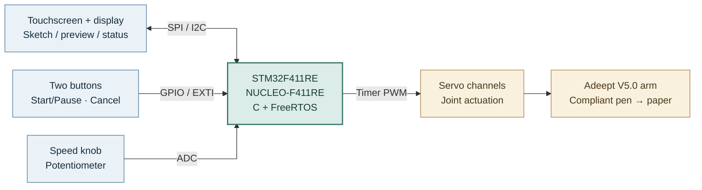
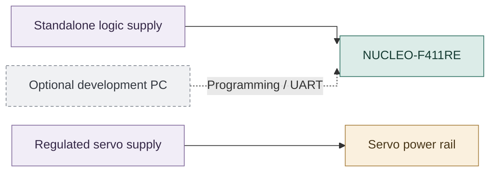
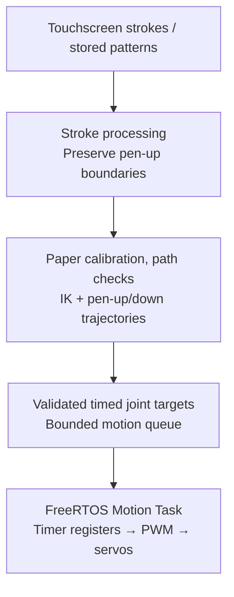
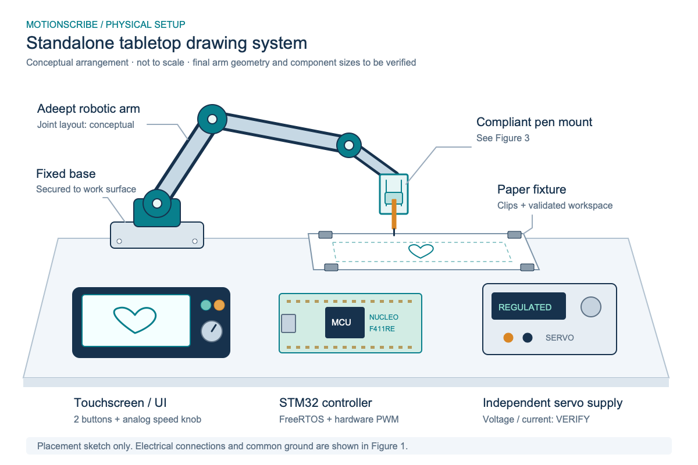
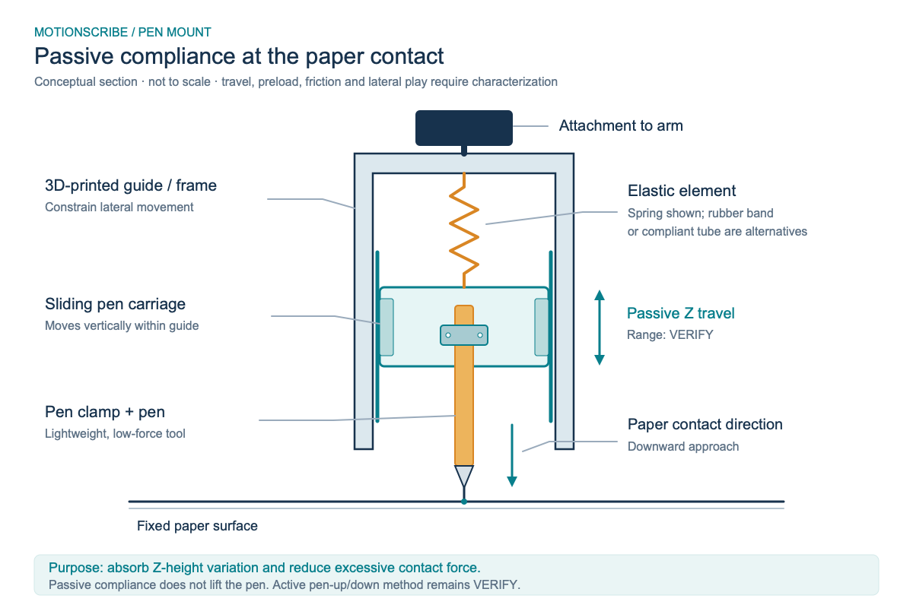

# MotionScribe — Final Project Proposal

*From Touchscreen to Paper: A Standalone Robotic Drawing System*

ESE 5190 — Smart Devices · University of Pennsylvania
Fangdong Yuan · Haoyu Shi · Ray Lin · October 25, 2026

*This proposal describes planned work and acceptance targets, not measured results. Hardware specifications, calibration parameters, and drawing performance will be verified during prototyping.*

## 1. Abstract

MotionScribe is an interactive tabletop system that turns touchscreen sketches and predefined patterns into drawings on paper. An STM32F411RE (NUCLEO-F411RE) running FreeRTOS will process user input, convert drawing paths into joint commands, and drive a modified Adeept ADA031-V5.0 robotic arm through hardware-timer PWM. Both drawing modes will share one firmware build and motion pipeline, with no PC required during operation. Our target is recognizable, repeatable drawings with clean separation between strokes, rather than precision-plotter accuracy.

## 2. Motivation

Drawing on a touchscreen is intuitive; reproducing that drawing with a robotic arm is not. Screen coordinates must be mapped to a calibrated physical workspace, converted into reachable joint positions, and executed with appropriate timing and pen contact. Touch input, display updates, motion planning, and servo control must also work together on a resource-constrained microcontroller.

MotionScribe turns these challenges into an interactive demonstration of register-level C programming, FreeRTOS, peripheral drivers, robot kinematics, mechanical design, and hardware–software integration. Rather than relying on the arm manufacturer’s control application, our team will develop and understand the STM32-based drawing and control firmware.

### 2.1 Feature priorities

We group features as **Must** (required for the final system), **Should** (improvements after the baseline works), and **May** (optional extensions). Only Must features are committed to the final demonstration; Sections 5 and 6 define their measurable requirements.

| Priority | Feature                                   | Expected behavior                                                                                                                              |
| -------- | ----------------------------------------- | ---------------------------------------------------------------------------------------------------------------------------------------------- |
| Must     | Draw What You Draw                        | Sketch a simple shape on the touchscreen, preview it, and have the arm reproduce it on paper.                                                  |
| Must     | Choose & Draw                             | Select a predefined pattern, such as a flower or smiley face, and have the arm draw it.                                                        |
| Must     | Standalone operation                      | Run both modes on the STM32 without a connected PC.                                                                                            |
| Must     | Physical controls                         | Use Start/Pause and Cancel buttons, plus an analog knob to select Slow/Normal/Fast drawing speeds. Park is a separate, validated motion state. |
| Must     | Stroke separation                         | Lift the pen during non-drawing moves so distinct strokes are not connected.                                                                   |
| Must     | Bounded motion                            | Reject invalid paths and keep commanded joint motion within calibrated limits.                                                                 |
| Should   | Drawing-quality refinement                | Improve smoothness and repeatability through better calibration and path sampling.                                                             |
| Should   | Adjustable patterns                       | Change parameters such as flower size or petal count.                                                                                          |
| May      | Pen-contact sensing                       | Add an FSR to measure pen contact after the passive mount has been validated.                                                                  |
| May      | More drawing inputs                       | Add text drawing or SVG import.                                                                                                                |
| May      | AI-assisted input                         | Explore natural-language or AI-generated drawing paths as an additional input source.                                                          |
| May      | ROS 2 integration                         | Explore an interface to an external ROS 2 system without making the baseline device PC-dependent.                                              |
| May      | Further hardware and interaction upgrades | Explore a custom PCB, external joint-position sensing, or sound/distance inputs.                                                               |

May features are potential future extensions, not dependencies of the standalone STM32 drawing system or requirements for the course demo.

### 2.2 Core engineering challenges

The main challenges are embedded control (timers, interrupts, ADC, SPI/I2C, and FreeRTOS scheduling), robot motion (coordinate mapping, inverse kinematics, and path timing), and physical integration (servo power, calibration, pen contact, and repeatability).

## 3. System Block Diagram

*Figure 1. Proposed hardware architecture.* The STM32 is the sole controller of the servos during normal operation. A PC may be connected for programming or diagnostics but is not part of the runtime system. Exact pin assignments, touch/display interfaces, servo channels, and supply ratings are subject to component verification.

*Figure 1a. Signal and motion flow.*

*Figure 1b. Power and development connections.* The MCU and servo blocks below refer to the same hardware shown above.

**Connection notes:** Both supplies, the MCU, and the servos share a common ground. The NUCLEO does not supply servo power. The PC connection is for development only. Touch/display interfaces, MCU pin assignments, servo channel mapping, and supply sources/ratings remain subject to verification.

The design includes at least two inputs (touchscreen, buttons, and a potentiometer), two outputs (display and robotic arm), an analog input connected to the ADC, and an SPI/I2C peripheral through the selected display/touch hardware. It also covers at least three course topics: timers/PWM, interrupts, RTOS, and advanced motion planning.

*Shared software pipeline.* Both drawing modes use one path representation and motion-control flow.

We plan three FreeRTOS tasks: Input/UI, Drawing/Planner, and Motion. Only the Motion Task updates servo commands; hardware timers generate PWM independently of display refresh or path computation. We will evaluate an initial motion-target update interval of approximately 20 ms. The speed knob will adjust trajectory timing, not the PWM frame frequency. The arm’s supplied controller may help with initial assembly checks, but it will not drive the same servos simultaneously with the STM32.

The firmware will enforce joint/workspace limits, bounded stroke and queue storage, and explicit Start/Pause/Cancel states. Cancel will invalidate unexecuted targets. Pause is not an emergency stop, and Park is a programmed posture rather than encoder-based homing. Without external position feedback, commanded joint targets must not be presented as measured joint or pen-tip positions.

## 4. Design Sketches

*Figure 2. Conceptual tabletop setup (not to scale).* The robotic arm, paper fixture, touchscreen, physical controls, STM32 board, and separate power supplies are arranged for standalone drawing. The arm base and paper will be securely mounted. Exact positions and electrical ratings will be confirmed during prototyping.

*Figure 3. Passive compliant pen mount (conceptual cross-section, not to scale).* A guided pen carriage and elastic element are intended to absorb small height variations and reduce excessive contact force. The guide may require 3D printing; its travel, preload, friction, and lateral play will be tested.

Our initial pen-up/down design combines the passive mount with arm Z-motion. A separate lift actuator is a fallback if early tests show inadequate clearance, contact consistency, or repeatability; it is not included in the current budget. We will test mount travel, friction, preload, return behavior, and lateral play, and confirm active joints and pen-tip orientation on the V5.0 hardware.

## 5. Software Requirements Specification (SRS)

These are proposed acceptance targets, not measured results. Any revisions will be based on documented prototype tests.

| ID     | Software requirement                                                                                                                                                                                                            | Verification method                                                                                                                            |
| ------ | ------------------------------------------------------------------------------------------------------------------------------------------------------------------------------------------------------------------------------- | ---------------------------------------------------------------------------------------------------------------------------------------------- |
| SRS-01 | The system shall execute touchscreen-sketch drawing and stored-pattern drawing using one firmware build and one shared drawing pipeline, without a runtime PC connection.                                                       | Disconnect the PC and complete both drawing workflows from onboard input to physical output.                                                   |
| SRS-02 | The software shall preserve separate strokes and generate pen-up travel between them.                                                                                                                                           | Use single- and multi-stroke test paths; inspect generated targets and pen-state transitions.                                                  |
| SRS-03 | During drawing, Start/Pause/Cancel events shall reach the command/state handler within 100 ms. Cancel shall invalidate unexecuted targets from the canceled job; 100 ms refers to event handling, not mechanical stopping time. | Timestamp events and state changes under display/planning load; cancel at different queue stages and verify that old targets are not executed. |
| SRS-04 | The software shall reject all cases in a defined invalid-path test set before drawing starts and display an error reason.                                                                                                       | Test out-of-workspace paths, unreachable points, and joint-limit violations; confirm rejection before actuator execution.                      |
| SRS-05 | Both drawing modes shall complete five consecutive trials without detected motion-queue corruption, buffer overrun, or unhandled task failure.                                                                                  | Record repeated trials and run boundary, queue-saturation, and memory/stack checks; drawing trials alone do not prove memory safety.           |
| SRS-06 | The Slow, Normal, and Fast settings shall produce three distinct motion-timing profiles without changing the servo PWM frame period.                                                                                            | Compare commanded target intervals or trajectory duration for the same pattern at each setting; capture PWM timing.                            |

## 6. Hardware Requirements Specification (HRS)

| ID     | Hardware requirement                                                                                                                                                                                                                                                                                                   | Verification method                                                                                                                                                                |
| ------ | ---------------------------------------------------------------------------------------------------------------------------------------------------------------------------------------------------------------------------------------------------------------------------------------------------------------------- | ---------------------------------------------------------------------------------------------------------------------------------------------------------------------------------- |
| HRS-01 | Each active servo channel shall meet the installed servo’s validated control-signal timing specification. The provisional 50 Hz target is a 20.0 ms ± 0.2 ms PWM period with commanded pulse widths accurate to ±10 µs. The initial plan uses three channels; the final channel count depends on joint/lift tests. | Capture all active channels with an oscilloscope or logic analyzer under simultaneous UI and planning activity. Confirm the servo timing specification before freezing the target. |
| HRS-02 | The system shall accept touchscreen input, two physical buttons, and an ADC-connected speed potentiometer. Each function shall pass 10 repeated trials; the knob shall distinguish Slow/Normal/Fast in 10 selection cycles.                                                                                            | Log touch/button events and ADC values; test every input function and speed setting.                                                                                               |
| HRS-03 | The system shall complete five consecutive drawings without an MCU reset caused by servo-power disturbances.                                                                                                                                                                                                           | Monitor logic/servo rails during multi-joint movements and record reset status.                                                                                                    |
| HRS-04 | The mechanism shall complete five consecutive pen-up transfers without an unintended connecting line on the calibrated paper setup.                                                                                                                                                                                    | Inspect paper output and record workspace, lift clearance, and settling time.                                                                                                      |
| HRS-05 | The arm/pen assembly shall complete a fixed line-and-square test pattern five consecutive times, with all intended strokes visibly present and contained within the calibrated drawing area.                                                                                                                           | Use a fixed drawing checklist and archived photos; separately measure geometric deviations and repeatability.                                                                      |

Drawing quality and workspace: We will compare lines, squares, circles, and hearts for recognizable shape, repeatability, and geometric deviation. 50 × 50 mm is the initial calibration area; 75 × 75 mm and 100 × 100 mm are candidate test regions where reachable. We will not claim millimeter-level drawing accuracy before measurement. Electrical PWM timing accuracy does not establish pen-tip positioning accuracy.

## 7. Bill of Materials (BOM)

**Required course BOM Google Sheet:** [MotionScribe_ESE5190_BOM](https://drive.google.com/file/d/1oGcbcZs6X4E95i8KPaif6jIvDnsdnPWG/view?usp=sharing)

The course budget is approximately $150 per team. The following costs match `MotionScribe_ESE5190_BOM`. These figures are planning estimates, not confirmed quotations; zero-cost items rely on course/lab loans, equipment, or materials stock.

| Component                     |  Qty. | Purpose                                     | Estimated cost | Status / dependency                                                            |
| ----------------------------- | ----: | ------------------------------------------- | -------------: | ------------------------------------------------------------------------------ |
| STM32 NUCLEO-F411RE           |     1 | Main microcontroller                        |             $0 | School loan planned; the budget manager has been contacted.                   |
| Adeept ADA031-V5.0 arm kit    |     1 | Arm and servos                              |            $70 | Confirm vendor approval, kit contents, and installed servo specifications.     |
| Touch LCD                     |     1 | Sketch input, preview, menus, and status    |             $0 | Course/lab loan preferred; SPI planned. Confirm controller, interface, 3.3 V compatibility, availability, and pins. |
| Potentiometer                 |     1 | Analog speed input via ADC                  |             $0 | Lab stock planned; select resistance and wiring.                              |
| Physical buttons              |     2 | Start/Pause and Cancel via GPIO             |             $0 | One pair/set from lab stock planned; debounce in firmware.                    |
| Regulated servo supply        |     1 | Separate actuator power                     |             $0 | Lab equipment; confirm voltage and peak current margin.                       |
| Wiring and connectors         | 1 set | Signal/power distribution and common ground |             $0 | Lab stock planned, including headers and power-distribution materials.        |
| Base and paper fixture        | 1 set | Secure drawing setup                        |             $0 | Lab/fabrication materials; finalize geometry and mounting hardware.           |
| Compliant pen-mount materials | 1 set | Guided carriage and elastic element         |             $8 | 3D-printed guide/sliding carriage plus spring or elastic element.              |
| Fasteners                     | 1 set | Mechanical assembly                         |             $5 | Screws, nuts, washers, and spacers; sizes/quantities depend on final layout.    |
| Lightweight pen               |     1 | Drawing tool                                |             $2 | Check fit and contact force.                                                   |
| Components subtotal           |       |                                             |            $85 | Based on the listed course/lab sourcing assumptions.                          |
| Shipping and tax reserve      |       |                                             |            $20 | Planning allowance; replace with actual checkout amounts.                     |
| **Planned total**              |       |                                             |       **$105** | **$45 below the $150 planning target.**                                       |

Parts will be sourced through approved purchasing channels after checking lab inventory. The arm kit is listed as Adeept ADA031-V5.0 and includes the arm and servos; the BOM provides the [Adeept product link](https://www.adeept.com/robotic-arm_p0453.html). MCU pin assignments are not yet specified. If any zero-cost item requires purchase or a separate lift actuator is required, the BOM and budget will be revised.

The supplied BOM does not separately list a standalone MCU/logic power supply. Its source and rating still need confirmation for PC-free operation; any additional purchase must be added to the budget.

The STM32 and servos will use separate power rails with a common ground; the NUCLEO will not power the servos. We will verify supply ratings, 3.3 V control-signal compatibility, startup transients, and an accessible servo-power disconnect. Software Pause is not an emergency stop; removing servo power may release holding torque.

## 8. Final Demo

The demo will take place on a secured tabletop with fixed paper, a touchscreen, physical controls, and standalone power. It does not require special facilities or a runtime PC.

1. **Start safely.** Check a known safe arm posture, enable servos using a validated startup procedure, and display READY. No external position feedback or automatic homing is assumed.
2. **Demo A — Draw What You Draw.** Draw a heart, smiley face, or simple multi-stroke sketch on the screen; preview it; then have the arm reproduce it on paper. Real-time imitation is not required.
3. **Show physical interaction.** Use Start/Pause/Cancel and the Slow/Normal/Fast knob. Demonstrate controlled handling of canceled motion.
4. **Demo B — Choose & Draw.** Select Flower or Happy Face and draw it using the same firmware and motion engine. The initial library is planned to contain approximately 3–5 simple patterns; a fixed Flower is the baseline, and Rainy Day is a possible addition.
5. **Confirm standalone operation.** Repeat both drawing modes with the PC disconnected and show representative drawing/test evidence.

Project deliverables will include firmware source code, wiring/pin documentation, the BOM, calibration notes, pen-mount design files, operating instructions, measurement records, photos, and demonstration media. Recorded commanded joint angles will not be described as measured arm positions.

## 9. Sprint Planning

Our critical path is power/PWM → joint calibration → reliable pen contact → stored-pattern drawing → touchscreen integration → repeated validation. Physical drawing feasibility takes priority over advanced UI features or optional pattern processing.

| Milestone                                | Planned work                                                                                                                                                       | Completion criterion                                               |
| ---------------------------------------- | ------------------------------------------------------------------------------------------------------------------------------------------------------------------ | ------------------------------------------------------------------ |
| Oct 26–Nov 1: Feasibility & interfaces  | Confirm arm, touch LCD, power, lab inventory, and documentation. Define key pins, interfaces, and memory limits; begin peripheral bring-up and FreeRTOS structure. | Main hardware dependencies identified and initial drivers running. |
| Nov 2–8: Power & mechanism              | Test independent power and PWM; measure joint geometry and safe limits; evaluate passive pen contact and basic IK. Meet with the Account Manager by Nov 6.         | Repeatable safe joint commands and documented pen-contact results. |
| Nov 9–15: First physical drawing        | Calibrate paper coordinates, generate line/square paths, implement pen-up/down, and validate rejected paths.                                                       | Draw a basic pattern using the STM32-controlled arm.               |
| Nov 16–20: MVP integration              | Integrate touch/display, both drawing modes, and preliminary SRS/HRS tests. No Detkin parts orders after Nov 16.                                                   | MVP Demo: November 20, 2026, during lab hours.                     |
| After MVP: Reliability & polish          | Improve drawing fidelity, interaction, queue behavior, and repeated-trial performance; prioritize measured issues.                                                 | All Must features work together on one firmware build.             |
| Before final demo: Validation & delivery | Freeze the system, run acceptance tests, document limitations, rehearse, and finalize report/video.                                                                | Final demonstration and supporting engineering evidence are ready. |

### 9.1 Team responsibilities

| Workstream                       | Primary ownership                                                                                                                                                 | Main deliverable                                                                     |
| -------------------------------- | ----------------------------------------------------------------------------------------------------------------------------------------------------------------- | ------------------------------------------------------------------------------------ |
| A — Embedded Platform & UI      | Register-level touch/display, button, ADC, and communication drivers; UI/preview; FreeRTOS coordination, queues, and command state machine.                       | Reliable user input, display feedback, and task/control interfaces.                  |
| B — Robotics & Drawing Engine   | Stroke processing, paper-coordinate mapping, joint geometry and calibration, FK/IK, path validation, trajectory timing, and pattern library.                      | Validated, timed joint targets for both drawing modes.                               |
| C — Hardware & Motion Execution | Sourcing; power and wiring; fixtures and compliant pen mount; servo bring-up; register-level timer/PWM driver and Motion Task; electrical and mechanical testing. | Reliable servo actuation, physical drawing setup, and measured hardware performance. |

Interfaces are separated at user commands, validated joint targets, and actuator execution. End-to-end integration and SRS/HRS validation span all three workstreams.

### 9.2 Major risks and response plans

| Risk                                         | Early test / mitigation                                                                                                                         |
| -------------------------------------------- | ----------------------------------------------------------------------------------------------------------------------------------------------- |
| Drawing reachability, pen angle, and contact | Measure the V5.0 linkage and servo limits; start with a 50 × 50 mm area; test passive compliance and pen-up clearance before complex patterns. |
| Touch hardware, memory, and drivers          | Confirm SPI/I2C controller chips and pin compatibility early; use partial display updates if a full framebuffer exceeds available SRAM.         |
| Power integrity and schedule                 | Check supply transients and signal levels; complete simple stored-pattern motion first; defer Should/May features if needed.                    |

### 9.3 Development and validation approach

We will write register-level C peripheral drivers and develop the final application logic ourselves; FreeRTOS provides task scheduling. Adeept examples, geometry references, and manufacturer documentation may inform the design but will not replace our original firmware. Any proposed external library will follow the course's documentation/approval requirements. AI tools will not be used to write the final-project firmware, in accordance with the course manual.

During implementation, we will record test evidence for key requirements and investigate failures in PWM timing, task/queue operation, memory bounds, joint calibration, stroke separation, power integrity, and drawing repeatability. Touch sampling limits and drawing quality will be measured rather than assumed; path resampling cannot recover touch points that were never captured.

## References

- [ESE 5190 Fall 2026 Final Project Manual](https://docs.google.com/document/d/17jUNs98_-TAvaIJuj3ORlqEL54Mr2z-0nuQrpoW8yvw/edit)
- [Adeept ADA031-V5.0 product page](https://www.adeept.com/robotic-arm_p0453.html)
- [Adeept V5.0 resources](https://www.adeept.com/learn/detail-103.html)
- [ST NUCLEO-F411RE board information](https://www.st.com/en/evaluation-tools/nucleo-f411re.html)
- [ST STM32F411RE microcontroller information](https://www.st.com/en/microcontrollers-microprocessors/stm32f411re.html)
