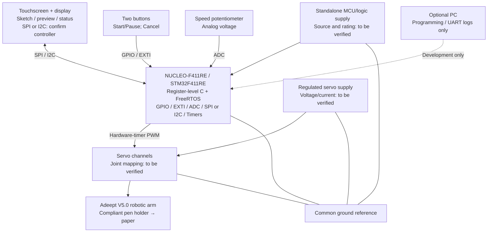
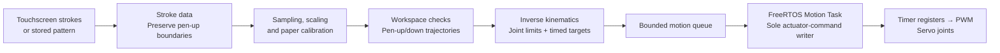
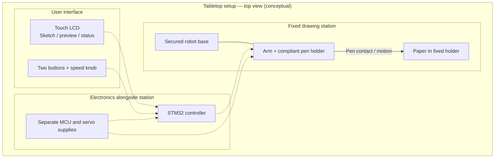

# MotionScribe — Proposal V2

### A Standalone Embedded Robotic Drawing System

**Course:** ESE 5190 — Smart Devices, University of Pennsylvania  
**Team:** Fangdong Yuan · Haoyu Shi · Ray Lin  
**Document:** Final Project Proposal — Version 2  
**Date:** October 25, 2026

> **Design status:** This proposal describes our intended system and preliminary acceptance targets, not completed experimental results. Hardware specifications, calibration parameters, and drawing performance will be confirmed through prototyping.

## 1. Abstract

**MotionScribe** is an interactive tabletop robot that turns touchscreen sketches and predefined patterns into drawings on paper. A **NUCLEO-F411RE (STM32F411RE)** running **FreeRTOS** will process user input, transform drawing paths into joint commands, and control a modified **Adeept ADA031-V5.0** robotic arm using hardware-timer PWM. Both drawing modes will use the same firmware and motion pipeline, with **no PC required during operation**. Our goal is to produce recognizable, repeatable drawings with clean separation between strokes, rather than precision-plotter accuracy.

## 2. Motivation

Drawing on a touchscreen is intuitive; reproducing that drawing with a robotic arm is not. Screen coordinates must be mapped to a calibrated physical workspace, converted into reachable joint positions, and executed with appropriate timing and pen contact. Touch input, display updates, motion planning, and servo control must also work together on a resource-constrained microcontroller.

MotionScribe makes these embedded-system challenges visible in an interactive device. The project brings together **register-level C programming, FreeRTOS, peripheral drivers, robot kinematics, mechanical design, and hardware–software integration**. Instead of relying on a supplied arm-control application, our team will develop and understand the final STM32-based drawing and control firmware.

### 2.1 Feature priorities

We use **Must / Should / Could** to separate committed features from enhancements. These priorities define project scope; the measurable acceptance criteria appear in Sections 5 and 6.

| Priority | Feature | Expected behavior |
| --- | --- | --- |
| **Must** | **Draw What You Draw** | A user sketches a simple shape on the touchscreen, previews it, and has the arm draw it on paper. |
| **Must** | **Choose & Draw** | A user selects a stored pattern, such as a flower or smiley face, for the arm to draw. |
| **Must** | **Standalone operation** | Both modes run on the STM32 without a connected PC. |
| **Must** | **Physical controls** | Two buttons provide Start/Pause and Cancel controls (with Park as a separate validated state); an analog knob selects Slow/Normal/Fast motion. |
| **Must** | **Separate strokes** | The pen lifts for non-drawing movements so separate strokes are not joined. |
| **Must** | **Safe, bounded commands** | Invalid paths are rejected, and commanded joint motion remains within calibrated limits. |
| **Should** | **Improved drawing quality** | Refine calibration and path sampling to improve smoothness and repeatability beyond the recognizable baseline. |
| **Should** | **Adjustable patterns** | Change simple pattern parameters, such as flower size or petal count. |
| **Could** | **Pen-contact sensing** | Add a force-sensitive resistor (FSR) to study pen contact after the passive mount is validated. |

**Outside this project's committed scope:** ROS 2, generative AI, natural-language drawing, SVG import, custom PCBs, and external joint-position feedback. Text drawing and additional sound/distance interactions are possible future extensions, not part of the required demonstration.

### 2.2 Core engineering challenges

The main challenges are **embedded control** (timers, interrupts, ADC, SPI/I2C, and FreeRTOS scheduling), **robot motion** (coordinate mapping, inverse kinematics, and path timing), and **physical integration** (servo power, calibration, pen contact, and repeatability).

## 3. System Block Diagram

**Figure 1. Proposed hardware architecture.** The STM32 is the sole controller of the servos during normal operation. A PC may be connected for programming or diagnostics but is not part of the runtime system. Exact pin assignments, touch/display interfaces, servo channels, and supply ratings are subject to component verification.



This design covers the course's required **inputs** (touchscreen, buttons, and an analog potentiometer), **outputs** (display and robotic arm), **ADC input**, and an **SPI/I2C peripheral** through the selected display/touch hardware. It also addresses at least three technical topics: **timers/PWM, interrupts, RTOS, and advanced motion planning**. We will confirm the potentiometer's acceptance as the analog input and the final display/touch interface with the teaching team.

**Figure 2. Shared software pipeline.** Both drawing modes use the same path representation and control flow.



We plan three FreeRTOS tasks: **Input/UI**, **Drawing/Planner**, and **Motion**. Only the Motion Task writes servo commands; hardware timers generate PWM independently of display refresh or path computation. An initial target-update interval of approximately **20 ms** will be evaluated. The speed knob changes trajectory timing, **not** the PWM frame frequency. A supplied controller may assist with initial assembly tests but will not drive servos simultaneously with the STM32.

**Control and safety boundaries:** The firmware will enforce joint/workspace limits, bounded stroke and queue storage, and explicit Start/Pause/Cancel states. Cancel will invalidate unexecuted targets; Pause is **not** an emergency stop, and Park is a programmed posture rather than encoder-based homing. The system has no external measurement of actual joint or pen-tip position; commanded motion must not be presented as measured positioning accuracy.

## 4. Design Sketches

**Figure 3. Proposed tabletop arrangement (conceptual, not to scale).** The arm base and paper will be firmly mounted, with the touchscreen and physical controls accessible to the user. The logic and servo supplies are separate.



**Figure 4. Passive compliant pen holder (conceptual cross-section, not to scale).** An elastic element gives the pen carriage limited vertical travel, compensating for small height differences between the arm and paper. This is a **mechanical concept**, not a finalized fabricated design.

```text
                 Robotic-arm end effector
                           │
                ┌──────────┴──────────┐
                │  Fixed guide/frame  │
                │                     │
                │  Elastic element    │
                │        ↕            │
                │  Sliding carriage   │  ← passive vertical travel
                └─────────┬───────────┘
                          │
                       Pen tip
                          ▼
              ───────────────────────   Paper
               Secured paper fixture
```

Our **initial pen-up/down approach** combines the passive mount with **arm Z-motion**. A separate lift actuator is a fallback only if early tests reveal inadequate clearance, contact consistency, or repeatability; it is **not included in the current budget**. We will test mount travel, friction, preload, return behavior, and lateral play. The active joint configuration and pen-tip orientation will be confirmed on the V5.0 hardware.

## 5. Software Requirements Specification (SRS)

These are **proposed, testable acceptance targets**, not measured results. Final values may be revised with the teaching team's agreement if early measurements reveal a hardware constraint.

| ID | Software requirement | Verification method |
| --- | --- | --- |
| **SRS-01** | The system **shall** execute touchscreen-sketch drawing and stored-pattern drawing using **one firmware build and one shared drawing pipeline**, without a runtime PC connection. | Disconnect the PC and complete both drawing workflows from onboard input to physical output. |
| **SRS-02** | The software **shall** preserve separate strokes and generate pen-up travel between them. | Use single- and multi-stroke test paths; inspect generated targets and pen-state transitions. |
| **SRS-03** | During drawing, Start/Pause/Cancel input events **shall** reach the command/state handler within **100 ms**. Cancel **shall** invalidate unexecuted targets from the canceled job. This is **not** a mechanical stopping-time requirement. | Timestamp events and state transitions under display/planning load; cancel at different queue stages and verify that old targets are not executed. |
| **SRS-04** | The software **shall** reject all cases in a defined invalid-path test set **before drawing starts** and display an error reason. | Test out-of-workspace paths, unreachable points, and joint-limit violations; confirm rejection before actuator execution. |
| **SRS-05** | Both required modes **shall** finish **five consecutive trials** without detected motion-queue corruption, buffer overrun, or unhandled task failure. | Record repeated trials; perform boundary and queue-saturation tests with memory/stack instrumentation. Running five drawings alone does not prove memory safety. |

## 6. Hardware Requirements Specification (HRS)

| ID | Hardware requirement | Verification method |
| --- | --- | --- |
| **HRS-01** | Each active servo channel **shall** meet the installed servo’s validated control-signal timing specification. The provisional 50 Hz target is a **20.0 ms ± 0.2 ms** PWM period with commanded pulse widths accurate to **±10 µs**. The initial plan uses three channels; the final channel count depends on joint/lift tests. | Capture all active channels with an oscilloscope or logic analyzer under simultaneous UI and planning activity. Confirm the servo timing specification before freezing the target. |
| **HRS-02** | The system **shall** accept touchscreen input, two physical buttons, and an ADC-connected speed potentiometer. Each function **shall** pass **10 repeated trials**; the knob **shall** distinguish Slow/Normal/Fast in 10 selection cycles. | Log touch/button events and ADC values; test every input function and speed setting. |
| **HRS-03** | The system **shall** complete **five consecutive drawings** without an MCU reset caused by servo-power disturbances. | Monitor logic/servo rails during multi-joint movements and record reset status. |
| **HRS-04** | The mechanism **shall** complete **five consecutive pen-up transfers** without an unintended connecting line on the calibrated paper setup. | Inspect paper output and record workspace, lift clearance, and settling time. |
| **HRS-05** | The arm/pen assembly **shall** complete a fixed **line-and-square test pattern five consecutive times**, with all intended strokes visibly present and contained within the calibrated drawing area. | Use a fixed drawing checklist and archived photos; separately measure geometric deviations and repeatability. |

**Drawing quality and workspace:** We will compare lines, squares, circles, and hearts for recognizable shape, repeatability, and geometric deviation. **50 × 50 mm** is the initial calibration area; **75 × 75 mm** and **100 × 100 mm** are candidate test regions where reachable. We will not claim millimeter-level drawing accuracy before measurement. Electrical PWM timing accuracy does not establish pen-tip positioning accuracy.

## 7. Bill of Materials (BOM)

**Required ESE 5190 BOM Google Sheet:** **[INSERT THE TEAM'S COMPLETED BOM SHEET LINK BEFORE SUBMISSION]**

The course budget is approximately **$150 per team**. Costs below are **planning allocations, not confirmed quotations**; zero-cost components depend on lab availability.

| Component | Qty. | Purpose | Estimated cost | Status / dependency |
| --- | ---: | --- | ---: | --- |
| STM32 NUCLEO-F411RE | 1 | Main microcontroller | $0 | Lab/course loan preferred; availability to be confirmed. |
| **Adeept ADA031-V5.0 arm kit** | 1 | Arm and servos | **$70** | Confirm vendor approval, kit contents, and installed servo specifications. |
| Touch LCD | 1 | Sketch input, preview, and status | $0 | Lab loan assumed; controller, bus interface, and logic levels to be confirmed. |
| Potentiometer | 1 | Analog speed input via ADC | $2 | Select value and wiring. |
| Physical buttons | 2 | Start/Pause and Cancel | $2 | Debounce in firmware. |
| Regulated servo supply | 1 | Separate actuator power | $20 | Confirm voltage and peak current margin. |
| Wiring and connectors | 1 set | Signal/power distribution and common ground | $8 | Confirm connectors and wire ratings. |
| Base and paper fixture | 1 set | Secure drawing setup | $8 | Lab or fabricated materials. |
| Compliant pen-mount materials | 1 set | Guided carriage and elastic element | $8 | May require 3D printing. |
| Fasteners | 1 set | Mechanical assembly | $5 | Check included kit hardware. |
| Lightweight pen | 1 | Drawing tool | $2 | Check fit and contact force. |
| Standalone MCU power supply | 1 | Operate without a PC | $0 | Borrowed USB wall adapter or suitable equivalent assumed. |
| **Components subtotal** | | | **$125** | Assumes MCU, display, and logic supply can be borrowed. |
| Shipping and tax reserve | | | **$20** | Final amount to be confirmed. |
| **Planned total** | | | **$145** | **$5 below** the $150 planning target. |

We will check the course's parts inventory before ordering and seek teaching-team approval for the arm's purchasing channel. **Student purchases are not reimbursed under the course policy.** A non-borrowed screen/MCU or an additional lift actuator would require an updated BOM and possibly a larger approved budget.

The STM32 and servos will use **separate power rails with a common ground**. The NUCLEO will **not** power the servos. We will verify servo supply voltage/current requirements, STM32-to-servo signal compatibility, startup transients, and an accessible servo-power disconnect. Software Pause is not an emergency stop; removing servo power may release holding torque.

## 8. Final Demo

The demo will take place on a secured tabletop with fixed paper, a touchscreen, physical controls, and standalone power. It does not require special facilities or a runtime PC.

1. **Start safely.** Check a known safe arm posture, enable servos using a validated startup procedure, and display **READY**. No external position feedback or automatic homing is assumed.
2. **Demo A — Draw What You Draw.** Draw a heart, smiley face, or simple multi-stroke sketch on the screen; preview it; then have the arm reproduce it on paper. **Real-time imitation is not required.**
3. **Show physical interaction.** Use Start/Pause/Cancel and the Slow/Normal/Fast knob. Demonstrate controlled handling of canceled motion.
4. **Demo B — Choose & Draw.** Select **Flower** or **Happy Face** and draw it using the same firmware and motion engine. The initial library is planned to contain approximately **3–5 simple patterns**; a fixed Flower is the baseline, and Rainy Day is a possible addition.
5. **Confirm standalone operation.** Repeat both drawing modes with the PC disconnected and show representative drawing/test evidence.

Project deliverables will include firmware source code, wiring/pin documentation, the BOM, calibration notes, pen-mount design files, operating instructions, measurement records, photos, and demonstration media. Recorded **commanded** joint angles will not be described as measured arm positions.

## 9. Sprint Planning

Our critical path is **power/PWM → joint calibration → reliable pen contact → stored-pattern drawing → touchscreen integration → repeated validation**. Physical drawing feasibility takes priority over advanced UI features or optional pattern processing.

| Milestone | Planned work | Completion criterion |
| --- | --- | --- |
| **Oct 26–Nov 1: Feasibility & interfaces** | Confirm arm, touch LCD, power, lab inventory, and documentation. Define key pins, interfaces, and memory limits; begin peripheral bring-up and FreeRTOS structure. | Main hardware dependencies identified and initial drivers running. |
| **Nov 2–8: Power & mechanism** | Test independent power and PWM; measure joint geometry and safe limits; evaluate passive pen contact and basic IK. **Meet with the Account Manager by Nov 6.** | Repeatable safe joint commands and documented pen-contact results. |
| **Nov 9–15: First physical drawing** | Calibrate paper coordinates, generate line/square paths, implement pen-up/down, and validate rejected paths. | Draw a basic pattern using the STM32-controlled arm. |
| **Nov 16–20: MVP integration** | Integrate touch/display, both drawing modes, and preliminary SRS/HRS tests. **No Detkin parts orders after Nov 16.** | **MVP Demo: November 20, 2026, during lab hours.** |
| **After MVP: Reliability & polish** | Improve drawing fidelity, interaction, queue behavior, and repeated-trial performance; prioritize measured issues. | All Must features work together on one firmware build. |
| **Before final demo: Validation & delivery** | Freeze the system, run acceptance tests, document limitations, rehearse, and finalize report/video. | Final demonstration and supporting engineering evidence are ready. |

### 9.1 Team responsibilities

| Workstream | Main responsibility | Coordination |
| --- | --- | --- |
| **A — Embedded Firmware & Integration** | Register-level drivers, FreeRTOS tasks/queues, command state machine, timer scheduling, and debugging. | Coordinate touch/display driver with C and motion commands with B. |
| **B — Robotics & Drawing Engine** | Stroke processing, geometry, FK/IK, calibration, waypoint/timing generation, and pattern library. | Measure arm geometry with C and integrate timed targets with A. |
| **C — Hardware & UI** | Procurement, power/wiring, fixtures, pen mount, UI behavior, and hardware testing. | Develop UI interfaces with A and perform calibration tests with B. |

**Ownership assignments are provisional.** Fangdong Yuan is proposed for **Workstream C**; A and B will be assigned by the team before submission. All three members will participate in regular full-system integration and must be able to explain the firmware architecture and critical drivers.

### 9.2 Major risks and response plans

| Risk | Early test / mitigation |
| --- | --- |
| **Drawing reachability, pen angle, and contact** | Measure the V5.0 linkage and servo limits; start with a 50 × 50 mm area; test passive compliance and pen-up clearance before complex patterns. |
| **Touch hardware, memory, and drivers** | Confirm SPI/I2C controller chips and pin compatibility early; use partial display updates if a full framebuffer exceeds available SRAM. |
| **Power integrity and schedule** | Check supply transients and signal levels; complete simple stored-pattern motion first; defer Should/Could features if needed. |

### 9.3 Development and validation approach

We will write **register-level C peripheral drivers** and develop the final application logic ourselves; **FreeRTOS** provides task scheduling. Adeept examples, geometry references, and manufacturer documentation may inform the design but will not replace our original firmware. Any proposed external library will follow the course's documentation/approval requirements. **AI tools will not be used to write the final-project firmware**, in accordance with the course manual.

During implementation, we will record test evidence for key requirements and investigate failures in **PWM timing, task/queue operation, memory bounds, joint calibration, stroke separation, power integrity, and drawing repeatability**. Touch sampling limits and drawing quality will be measured rather than assumed; path resampling cannot recover touch points that were never captured.

## References

- [ESE 5190 Fall 2026 Final Project Manual](https://docs.google.com/document/d/17jUNs98_-TAvaIJuj3ORlqEL54Mr2z-0nuQrpoW8yvw/edit)
- [Adeept ADA031-V5.0 product page](https://www.adeept.com/robotic-arm_p0453.html)
- [Adeept V5.0 resources](https://www.adeept.com/learn/detail-103.html)
- [ST NUCLEO-F411RE board information](https://www.st.com/en/evaluation-tools/nucleo-f411re.html)
- [ST STM32F411RE microcontroller information](https://www.st.com/en/microcontrollers-microprocessors/stm32f411re.html)
