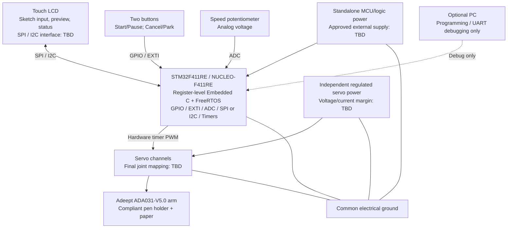
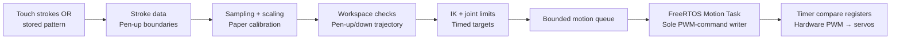
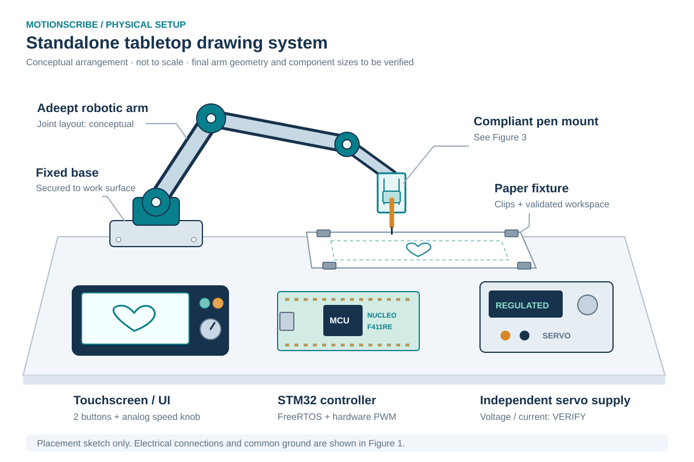
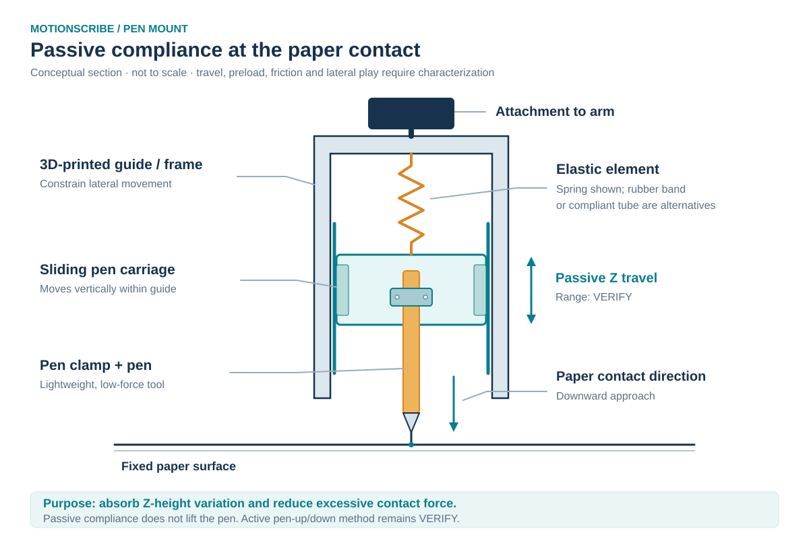

# MotionScribe: A Standalone Embedded Robotic Drawing System

**Course:** ESE 5190 — Smart Devices, University of Pennsylvania  
**Team:** Fangdong Yuan · Haoyu Shi · Ray Lin  
**Document:** Final Project Proposal  
**Date:** October 25, 2026

> **Proposal status:** This document describes our planned design and acceptance targets, not completed experimental results. Hardware-dependent decisions will be confirmed during early prototyping. The final project will be developed in the course GitHub repository.

## 1. Abstract

**MotionScribe** is an interactive tabletop robot that turns touchscreen sketches and selected patterns into physical drawings on paper. A **NUCLEO-F411RE (STM32F411RE)** running **FreeRTOS** will handle the user interface, coordinate processing, inverse kinematics (IK), motion commands, and hardware-timer PWM for a modified Adeept robotic arm. Both drawing modes will share one firmware pipeline and operate **without a PC during use**. Our goal is to produce recognizable, repeatable drawings with clean separation between strokes—not precision-plotter accuracy.

## 2. Motivation

A user draws in screen coordinates, but a robotic arm must move a pen through physical space. Connecting these two representations requires coordinate calibration, reachable joint targets, controlled motion timing, and consistent pen contact. The challenge is greater on a resource-constrained microcontroller, where touchscreen input and display updates must coexist with reliable actuator commands.

MotionScribe makes this embedded-systems problem visible and interactive. It combines **register-level peripheral programming, RTOS task coordination, robotics algorithms, electrical integration, and mechanical design** into a working device. Rather than simply running an arm kit's example program, we will implement the STM32-based application and motion-control pipeline ourselves.

### Feature scope

We use **Must / Should / Could** to distinguish committed baseline behavior from enhancements; these priorities do not replace the testable SRS/HRS requirements below.

| Priority | Feature | User-visible behavior |
| --- | --- | --- |
| **Must** | **Draw What You Draw** | Sketch a simple shape on the touchscreen, preview the strokes, and have the arm draw them on paper. |
| **Must** | **Choose & Draw** | Select a stored pattern such as **Flower** or **Happy Face**; both modes use the same drawing engine. |
| **Must** | **Standalone operation** | Run the complete drawing workflow without a connected PC. |
| **Must** | **Physical interaction** | Use two buttons for Start/Pause and Cancel/Park, plus an analog knob for Slow/Normal/Fast. |
| **Must** | **Separate strokes** | Lift the pen between independent strokes to avoid unwanted connecting lines. |
| **Must** | **Bounded motion** | Reject invalid drawing requests and keep commanded motion within calibrated limits. |
| **Should** | **Improved drawing quality** | Refine calibration and path sampling to improve shape fidelity and consistency. |
| **Should** | **Adjustable patterns** | Vary parameters such as flower size or petal count. |
| **Could** | **Contact sensing** | Add an FSR to study pen pressure after the passive pen mount is validated. |

**Out of scope for the baseline:** ROS 2, generative AI, natural-language drawing, SVG import, custom PCB development, and feedback-equipped actuators. Additional text, sound, or distance-triggered modes are future ideas, not committed deliverables.

### Main technical challenges

1. **Embedded control:** Use register-level C, interrupts, ADC, SPI/I2C, FreeRTOS, and timer-driven PWM without blocking motion updates.
2. **Robot geometry:** Map strokes from screen to paper coordinates, solve IK, and generate bounded, continuous motion targets.
3. **Physical integration:** Achieve stable pen contact and pen-up clearance despite servo backlash, deadband, uncertain positioning, and power transients.

## 3. System Block Diagram

**Figure 1. Proposed hardware architecture.** The STM32 owns final actuator control; a computer is optional for firmware development and logging, **not** for running the demos. Exact display/touch interfaces, servo channels, supply ratings, and pin assignments will be fixed after component verification.

The architecture covers **three or more required course topics** (timers/PWM, interrupts, RTOS, and advanced motion planning), **at least two input devices** (touchscreen, buttons, potentiometer), **two output devices** (display, robotic arm), **one ADC analog input** (potentiometer), and **one SPI/I2C peripheral** (touch/display hardware, model pending confirmation). The exact analog-input classification and peripheral choice will be checked with the teaching team.

**Shared software pipeline:**

Three planned tasks separate **Input/UI**, **Drawing/Planner**, and **Motion**. The Motion Task is the only writer of actuator commands; hardware timers generate PWM edges independently of task scheduling. The controller updates target commands on an initial **~20 ms** schedule, while a speed knob changes trajectory timing—not the servo PWM frame rate. A supplied arm controller may be used for initial assembly checks but will **not** simultaneously drive the servos with the STM32.

## 4. Design Sketches

**Figure 2. Conceptual tabletop arrangement (not to scale).** The arm and paper fixture will be secured to a work surface, with the touchscreen, MCU board, physical controls, and independent servo supply nearby.

**Figure 3. Conceptual passive compliant pen mount (not to scale).** A guided sliding carriage and elastic element help accommodate small paper-height variations without applying excessive force.

**Mechanical baseline:** A passive compliant pen holder with **arm Z-motion for pen-up/down** is the first design to test. A separate lift actuator is a contingency **only if** clearance, load, or repeatability tests show it is necessary; it is **not included in the current BOM**. We will characterize vertical travel, preload, friction, return behavior, and lateral play. A custom guide may be 3D-printed. FSR sensing is optional and follows basic mechanical validation.

## 5. Software Requirements Specification (SRS)

The following are **proposed acceptance targets**, not measured results. Tests will be repeated and documented during development.

| ID | Software requirement | Verification method |
| --- | --- | --- |
| **SRS-01** | The system **shall** execute touchscreen-sketch drawing and stored-pattern drawing from a **single firmware build and shared pipeline**, without a runtime PC connection. | Disconnect the PC; complete both end-to-end demonstrations using onboard input and physical drawing output. |
| **SRS-02** | The system **shall** preserve stroke boundaries and insert pen-up travel between separate strokes. | Test predefined one-stroke and multi-stroke paths; compare captured stroke boundaries and emitted pen-state commands. |
| **SRS-03** | During drawing, **Start/Pause/Cancel** events **shall** be processed into the command/state machine within **100 ms**; Cancel **shall** invalidate pending targets from the canceled job. This does **not** specify mechanical stopping time. | Timestamp input events and state handling under UI/planning load; cancel at several queue stages and verify that canceled targets are not subsequently executed. |
| **SRS-04** | The system **shall** reject every request in a defined invalid-path test set **before drawing begins**, with a displayed reason. | Submit out-of-workspace, unreachable, and joint-limit-violating paths; record rejection and verify no drawing-motion execution. |
| **SRS-05** | Both required modes **shall** complete **five consecutive trials** without motion-queue corruption or out-of-bounds memory access. | Record trials, apply buffer-bound checks/instrumentation, and test queue saturation and repeated start/cancel cycles. Runtime success alone is not evidence of memory safety. |

## 6. Hardware Requirements Specification (HRS)

| ID | Hardware requirement | Verification method |
| --- | --- | --- |
| **HRS-01** | All active servo channels **shall** generate **20.0 ms ± 0.2 ms PWM periods** and pulse widths within **±10 µs** of commanded values, **subject to confirming 50 Hz compatibility with the installed servos**. Three channels are the initial plan; the final count depends on the lift/joint configuration. | Measure channels with an oscilloscope or logic analyzer during simultaneous UI/planner activity; revise the target before final validation if servo specifications require a different frame rate. |
| **HRS-02** | The system **shall** support touch input, **two physical buttons**, and an **ADC-connected speed potentiometer**. Each input **shall** operate correctly in **10 trials**; the knob **shall** distinguish **Slow/Normal/Fast** in 10 selection cycles. | Log touch/button events and ADC ranges; repeat each function and the three speed selections. |
| **HRS-03** | The system **shall** complete **five consecutive drawings** without an MCU reset caused by servo-power disturbances. | Log reset reasons and monitor logic/servo supply behavior during simultaneous-joint movements. |
| **HRS-04** | The mechanism **shall** complete **five consecutive pen-up transfers** without an unintended connecting line in the calibrated paper setup. | Inspect each drawing; record clearance, lift approach, workspace, and settling interval. |
| **HRS-05** | The integrated arm and pen assembly **shall** complete **five consecutive executions** of a predefined line-and-square test drawing without missing intended strokes. | Compare paper output to a fixed stroke-completion checklist, archive photos, and record geometric deviation separately as characterization data. |

**Drawing-quality note:** We will compare line, square, circle, and heart drawings for shape fidelity, repeatability, and absolute deviation. An initial **50 × 50 mm** calibrated workspace is a starting point; **75 × 75 mm** and **100 × 100 mm** will be evaluated only where reachable. We do **not** promise millimeter-level pen-tip accuracy before mechanical characterization. Accurate PWM output alone does not prove accurate pen positioning.

## 7. Bill of Materials (BOM)

**Required course BOM Google Sheet:** **[ADD THE TEAM'S COMPLETED ESE 5190 BOM SHEET LINK BEFORE SUBMISSION]**

The course budget is approximately **$150 per team**. The allocations below are planning estimates, **not confirmed vendor quotations**. Zero-cost items assume lab availability. Tax and shipping have a separate reserve.

| Component | Qty. | Purpose | Planned cost | Status / dependency |
| --- | ---: | --- | ---: | --- |
| STM32 NUCLEO-F411RE | 1 | Main MCU | $0 | Borrow from course/lab if available. |
| **Adeept ADA031-V5.0** arm kit | 1 | Mechanical arm and servos | **$70** | Confirm kit/version, purchasing approval, and installed servo specifications. |
| Touch LCD | 1 | Sketch entry, preview, status | $0 | Lab loan assumed; **controller, SPI/I2C interface, and logic levels TBD**. |
| Potentiometer | 1 | Required ADC analog input / speed | $2 | Value/wiring TBD. |
| Physical buttons | 2 | Start/Pause; Cancel/Park | $2 | Debounce in firmware. |
| Regulated servo supply | 1 | Independent actuator power | $20 | Match installed servos' voltage and peak current. |
| Wiring/connectors | 1 set | Signals, supply distribution, common ground | $8 | Confirm power/wire ratings. |
| Arm base / paper fixture | 1 set | Secure drawing area | $8 | Lab fabrication/materials. |
| Compliant pen-mount materials | 1 set | Guide/carriage and elastic element | $8 | May require 3D printing. |
| Fasteners | 1 set | Mechanical assembly | $5 | Check kit contents first. |
| Lightweight pen | 1 | Drawing tool | $2 | Confirm pen force and mount fit. |
| MCU/logic standalone supply | 1 | MCU operation without PC | $0 | Borrowed USB wall supply or approved equivalent assumed; **confirm**. |
| **Components subtotal** | | | **$125** | Conditional on borrowed parts. |
| Shipping and tax reserve | | | **$20** | Final checkout amount pending. |
| **Planned total** | | | **$145** | **$5 remaining** against the $150 planning target. |

**Procurement notes:** Verify the lab peripherals inventory before ordering; confirm the arm vendor/channel and extra parts with the teaching team. **Do not purchase personally expecting reimbursement.** A separate lift servo or unavailable loaner hardware would require a revised BOM and possibly additional budget approval. The V5.0 product listing confirms **two AD004 high-torque servos**; the complete installed servo mapping and other servo models must be checked against the actual kit. We plan to use **separate MCU and servo power rails with a common ground**, and an accessible servo-power disconnect. The NUCLEO will not power the servos.

## 8. Final Demo

The demonstration uses a **secured tabletop arm and paper fixture**, a touchscreen with controls, and a stand-alone power arrangement. No special venue or PC-dependent runtime interaction is intended.

1. **Startup and readiness:** Confirm a known safe physical posture, enable servo commands through a tested startup sequence, and display **READY**. PWM is initially disabled while the safe sequence is checked. No external joint encoder/automatic homing is assumed.
2. **Demo A — Draw What You Draw:** Sketch a heart, smiley face, or simple strokes on the screen; preview; confirm; then watch the arm reproduce them. **Real-time imitation is not required.**
3. **Physical interaction:** Show Start/Pause/Cancel and Slow/Normal/Fast control. Cancel stops issuing the canceled job's remaining targets; **Pause is not an emergency stop**, and Park is a programmed posture rather than homing.
4. **Demo B — Choose & Draw:** Select **Flower** or **Happy Face** and draw it through the **same firmware and drawing engine**. We aim for a small library of **3–5 patterns**; a fixed Flower is part of the baseline, while Rainy Day is a candidate.
5. **Standalone proof and engineering evidence:** Repeat both modes with the PC disconnected. Present representative drawings and, if useful, separate scope/logic-analyzer captures and logged test results.

The final project materials will include **source firmware, pin/wiring documentation, BOM, calibration records, fabricated pen-mount files, operating instructions, validation results, and demonstration media**. The final report will distinguish commanded angles from measured physical motion.

## 9. Sprint Planning

**Critical sequence:** power/PWM → joint calibration → pen contact → first stored-pattern drawing → touchscreen integration → repeatable demonstrations. We prioritize a physical drawing milestone before advanced UI or path optimization.

| Window / checkpoint | Main work | Exit criterion |
| --- | --- | --- |
| **Oct 26–Nov 1 — Interfaces and feasibility** | Confirm arm, LCD, power, lab stock, vendor documentation, MCU pins/memory budget; begin register-level drivers and FreeRTOS setup. | Critical parts/interface choices recorded; basic peripheral bring-up started. |
| **Nov 2–8 — Power, geometry, pen mount** | Validate logic/servo power, PWM, startup procedure, joint directions/limits, initial IK model, and first passive pen mount. **Meet account manager about parts by Nov 6.** | Repeatable conservative joint commands and documented pen-contact test. |
| **Nov 9–15 — First physical drawing** | Implement stored strokes, coordinate calibration, line/square motion, and basic pen-up/down. Validate invalid-path rejection. | Arm completes a simple physical drawing through STM32 firmware. |
| **Nov 16–20 — MVP integration** | Connect touch/display with the shared pipeline, validate both workflows at a basic level, collect initial SRS/HRS evidence. **Course ordering closes Nov 16.** | **MVP Demo: Nov 20, 2026**, during lab hours. |
| **After MVP — Refinement** | Improve stroke processing, Pause/Cancel, speed settings, reliability, drawing quality, and documentation; address measured issues first. | All Must behaviors integrated and repeatable. |
| **Before final demonstration — Validation** | Freeze configuration, repeat acceptance tests, document deviations/limitations, rehearse demo, finalize report and video. | Test records and final demo package ready; final date follows the course schedule. |

### Team responsibilities

| Workstream | Primary ownership | Coordination |
| --- | --- | --- |
| **A — Embedded Firmware & Integration** | Register-level drivers; FreeRTOS tasks/queues; command state machine; timer scheduling; UART/debug logs. | Coordinate display-driver interfaces with C and joint-command interfaces with B. |
| **B — Robotics & Drawing Engine** | Stroke processing; geometry and calibration; FK/IK; bounded waypoint planning; joint limits; stored patterns. | Measure physical geometry and pen contact with C; integrate timed targets with A. |
| **C — Hardware & User Interface** | Component sourcing; independent power/wiring; fixtures and compliant pen mount; UI layout and behavior; hardware testing. | Define touch/UI behavior with A and perform joint calibration with B. |

**Named workstream owners:** to be agreed by **Fangdong Yuan, Haoyu Shi, and Ray Lin** at the team meeting; the responsibilities above are the proposed division, not an invented assignment of names. All three members will attend **at least one integrated system test per week** and be able to explain the firmware architecture and full control chain.

### Key risks and mitigation

| Risk | Mitigation / fallback |
| --- | --- |
| **Pen contact, reachability, and drawing fidelity** | Measure the V5.0 joint geometry early; test a 50 × 50 mm workspace and passive pen mount; use simpler shapes or revise lift strategy if necessary. |
| **Touchscreen interface or memory limits** | Confirm display/touch controller and SPI/I2C early; use partial display updates rather than assuming a full-screen framebuffer fits in the STM32's **128 KB SRAM**. |
| **Power, schedule, and sourcing uncertainty** | Confirm both supply rails and approved purchasing route; test current transients and resets; finish stored-pattern motion before touchscreen integration; defer Should/Could features if needed. |

### Implementation boundaries and engineering records

The project uses **register-level C for the STM32 peripherals** and **FreeRTOS for scheduling**. Vendor examples, geometry data, and manuals may be consulted as **references**, but the final motion planning, drivers, and application logic will be authored and understood by our team in accordance with course rules. If an external library is proposed, we will seek teaching-team guidance and document its operation as required. AI tools will **not** be used to write the final-project firmware.

Our implementation will preserve the following engineering constraints:

- **Single command owner:** the Motion Task alone updates servo timer compare registers; short interrupt handlers notify tasks rather than running IK; logging and display refresh must not block motion.
- **Bounded data and safe commands:** store strokes with explicit pen-up boundaries; cap stroke/point counts and queue usage; reject invalid paths before drawing; handle queue-full or unexpected underrun deterministically.
- **Defined state handling:** `INIT → IDLE → PREVIEW → DRAWING ↔ PAUSED → DONE`, with `FAULT` for errors. `CANCEL` invalidates queued work; `PARK` uses a validated commanded posture, **not** measured homing.
- **Calibration and validation:** measure link lengths, joint directions, zero offsets, PWM-to-angle mapping, joint limits, pen-tip offsets, paper transform, and candidate collision/singularity limits. Evaluate touch report rate and dropped reports; resampling cannot reconstruct points that were never sampled.
- **Honest limitations:** the servos do not provide external pen-tip position feedback to the STM32. `DONE` means planned commands plus a characterized settling interval have completed; it does **not** imply measured positional accuracy or automatic stall detection.
- **Electrical safety:** verify installed servo voltage/current and signal compatibility; use separate regulated actuator power and a common reference ground. A software Pause is not an emergency stop; cutting servo power can release holding torque.

## References

- [ESE 5190 Fall 2026 Final Project Manual](https://docs.google.com/document/d/17jUNs98_-TAvaIJuj3ORlqEL54Mr2z-0nuQrpoW8yvw/edit)
- [Adeept ADA031-V5.0 product page](https://www.adeept.com/robotic-arm_p0453.html)
- [Adeept V5.0 resources](https://www.adeept.com/learn/detail-103.html)
- [ST NUCLEO-F411RE board information](https://www.st.com/en/evaluation-tools/nucleo-f411re.html)
- [ST STM32F411RE device information](https://www.st.com/en/microcontrollers-microprocessors/stm32f411re.html)
